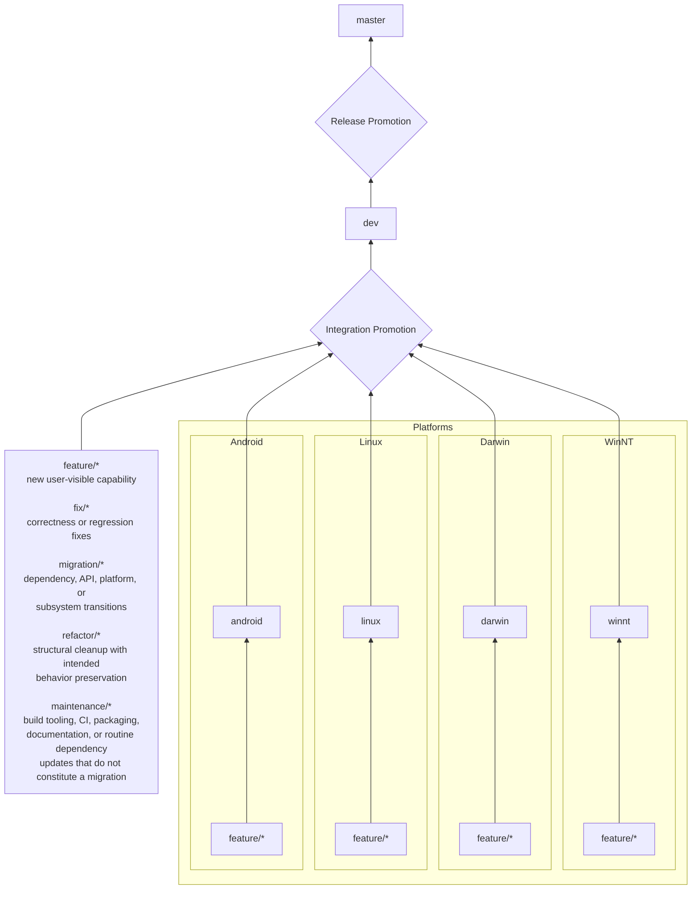

# Branching & Promotion Workflow

This project uses a promotion-based workflow rather than a traditional GitFlow model.

The goal is to ensure every change earns its way into the main codebase through increasing levels of confidence.

## This is a Living Document

This workflow exists to support development, not restrict it.

If experience shows a better approach, update this document first, then update the workflow.

The process serves the project.
The project does not serve the process.

---

## Philosophy

Branches do **not** represent different versions of the emulator.

Branches represent different **levels of confidence**.

Each promotion answers a different question.

``` text
Feature
    ↓
Platform
    ↓
Integration
    ↓
Production
```

---

## Promotion Pipeline



---

### master

Purpose:

- Production branch
- Always releasable
- All releases and tags originate here

Rules:

- Never commit directly
- Only receives promoted code from `dev`
- Every commit should represent a potentially shippable state

---

### dev

Purpose:

- Integration branch
- Nightly build source
- Release Candidate source

Rules:

- Receives completed work from:
  - feature branches
  - platform branches
- All active work must coexist here
- Used to validate cross-platform compatibility
- RC tags are created from this branch

Questions answered:

> Does everything work together?

---

### android

Purpose:

Android platform integration.

Owns work specific to:

- Android build
- Gradle
- JNI
- Android UI
- Input
- Packaging
- Mobile-specific behavior

Should **not** become the owner of emulator-core fixes.

---

### linux

Purpose:

Linux platform integration.

Owns work specific to:

- Linux build
- Packaging
- Toolchain
- Desktop integration

---

### darwin

Purpose:

Apple platform integration.

Owns work specific to:

- macOS builds
- App bundle
- Codesigning
- Notarization
- Apple-specific APIs

---

### winnt

Purpose:

Windows platform integration.

Owns work specific to:

- Windows build
- Visual Studio
- Installer
- Windows-specific APIs

---

## Work Branches

The `feature/*` box in the promotion flowchart represents all temporary, platform-independent work branches. These are collectively the **other** work type.

Use one of these prefixes to make the branch's purpose clear:

- `feature/*` — new user-visible capability
- `fix/*` — correctness or regression fix
- `migration/*` — dependency, API, platform, or subsystem transition
- `refactor/*` — structural cleanup with intended behavior preservation
- `maintenance/*` — build tooling, CI, packaging, documentation, or routine dependency update that is not a migration

Work branches are temporary.

Examples:

``` text
feature/new-memorycard
fix/cdrom-read-retry
migration/sdl3
refactor/build-noise
maintenance/license-audit
```

Work branches should be used whenever work is:

- emulator-core
- platform-independent
- experimental
- isolated

Delete after promotion.

---

## Experiment Branches

Experiments are intentionally disposable.

Examples:

``` text
experiment/sw-rasterizer
experiment/new-renderer
experiment/audio-rewrite
```

Rules:

- No expectation of success
- Safe place to explore
- Delete when finished (successful or not)

---

## Promotion Rules

### Work Branch → Dev

Allowed when:

- Feature builds successfully
- Appropriate testing completed
- Ready for integration

Question answered:

> Does this work change correctly?

---

### Work Branch → Platform

Allowed when:

The feature primarily affects a single host platform.

Question answered:

> Does this work on this platform?

---

### Platform → Dev

Allowed when:

- Platform work is complete
- Platform builds successfully
- Cross-platform smoke tests pass

Question answered:

> Does this platform still coexist with everything else?

---

### Dev → Master

Allowed when:

- Integration is stable
- RC testing complete
- Release approved

Question answered:

> Would I ship this?

---

## CI Expectations

### Platform Branches

Primary purpose:

Validate platform-specific work.

Typical jobs:

- Build target platform
- Optional cross-platform compile verification

---

### dev

Primary purpose:

Integration validation.

Typical jobs:

- Full build matrix
- Automated tests
- Nightly artifacts
- Smoke testing

---

### master

Primary purpose:

Release.

Typical jobs:

- Full build matrix
- Packaging
- Signing
- Checksums
- GitHub Release

---

## Ownership Rules

Platform branches own:

- build systems
- packaging
- deployment
- platform APIs
- platform UI

Platform branches do NOT own:

- emulator core
- CPU
- GPU
- SPU
- Memory cards
- Disc subsystem
- Generic bug fixes

Those belong in work branches.

---

## Branch Lifetime

Persistent:

``` text
master
dev
android
linux
darwin
winnt
```

Temporary:

``` text
feature/*
fix/*
migration/*
refactor/*
maintenance/*
experiment/*
hotfix/*
```

Temporary branches should be deleted after promotion.

---

## Guiding Principle

Every branch should be moving toward `master`.

No branch should become a permanent alternate version of the emulator.

Every promotion increases confidence:

Feature
→ Platform
→ Integration
→ Production

The goal is not merely to compile.

The goal is to ensure that every promoted change is understood, validated, and increasingly trusted before becoming part of a release.
